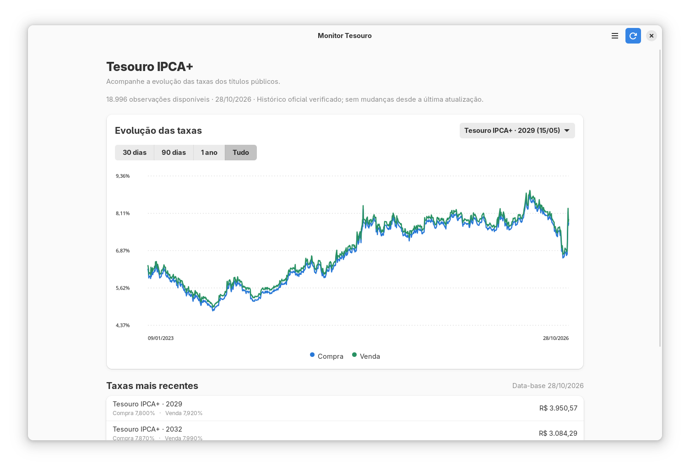

# Monitor Tesouro

[](https://github.com/victorffrock/monitor-tesouro/actions/workflows/ci.yml)
[](https://github.com/victorffrock/monitor-tesouro/releases/latest)

Aplicativo Linux para acompanhar as taxas dos títulos públicos Tesouro IPCA+, comparar compra e venda ao longo do tempo e consultar cotações recentes.



## Recursos

- Gráfico histórico amplo com as taxas de compra e venda.
- Filtros de 30 dias, 90 dias, um ano ou todo o histórico.
- Seleção por vencimento e lista de cotações mais recentes.
- Histórico oficial do Tesouro Transparente, mesmo em uma instalação nova.
- Cache local para abrir os dados anteriores quando estiver sem conexão.
- Interface GTK 4 e libadwaita, seguindo os padrões visuais do GNOME.
- AppImage com runtime incluído, launcher sem FUSE e suporte a atualização pelo Gear Lever.
- Notificações opcionais na área de trabalho quando as taxas cruzam os limites configurados.

A aplicação não envia e-mails, não pede senha SMTP e não é recomendação de investimento.

## Baixar

Baixe a versão mais recente na página de [Releases](https://github.com/victorffrock/monitor-tesouro/releases/latest). O release inclui:

- `Monitor-Tesouro-x86_64.AppImage`: aplicativo gráfico e runtime incluído.
- `Monitor-Tesouro-x86_64.AppImage.zsync`: arquivo de atualização incremental.
- `Monitor-Tesouro-sem-fuse.sh`: launcher opcional para iniciar sem FUSE. Mantenha-o na mesma pasta do AppImage.

Marque o AppImage como executável e abra-o. Para usar o launcher, execute `./Monitor-Tesouro-sem-fuse.sh` na pasta onde os dois arquivos foram salvos.

## Histórico de taxas

O gráfico consulta a série diária pública do Tesouro Transparente, com dados desde 2002. Na primeira execução, o app baixa a série oficial e guarda uma cópia comprimida em cache. Atualizações posteriores verificam se há dados novos; sem conexão, o cache continua disponível.

## Atualizações pelo Gear Lever

O AppImage publica metadados `.zsync` para atualização pelo Gear Lever. A versão atualizada do pacote usa uma URL estável de download do arquivo `.zsync`, sem consultar a API REST de releases do GitHub. Isso evita que a verificação dependa da cota anônima dessa API.

## Créditos

O diálogo **Sobre o Monitor Tesouro** identifica **Victor Ferreira Franco** como desenvolvedor e informa que o projeto teve assistência de inteligência artificial (**OpenAI Codex**). O código é distribuído sob a licença GPL-3.0-only.

## Privacidade

A aplicação consulta apenas dados públicos do Tesouro Transparente. Configuração, histórico e logs ficam localmente em `~/.local/share/monitor-tesouro/`.

## Executar pelo código-fonte

Requer Python 3.11+, GTK 4, libadwaita, PyGObject e Cairo. No Ubuntu, instale `python3-gi`, `python3-gi-cairo`, `gir1.2-gtk-4.0` e `gir1.2-adw-1`. Em seguida:

```bash
PYTHONPATH=src python -m monitor_tesouro
```

## Desenvolvimento

```bash
python -m pip install -e '.[dev]'
ruff check --select E4,E7,E9,F src tests
PYTHONPATH=src python -m unittest discover -s tests -v
python -m build
```

A CI executa os testes em Python 3.11, 3.12 e 3.13, verifica lint e build e testa a janela GTK/libadwaita. O CodeQL analisa o código em pull requests.

## Build do AppImage

O workflow gera e anexa o AppImage, o arquivo `.zsync` e o launcher sem FUSE quando uma GitHub Release é publicada. Para instruções do build local, consulte [packaging/README.md](packaging/README.md).

## Licença

GPL-3.0-only. Consulte [LICENSE](LICENSE).
